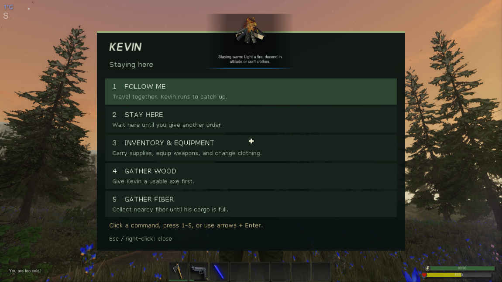

# Kevin Companion for Subsistence

## [DOWNLOAD KEVIN SETUP — CLICK HERE](https://github.com/SimpleNeb/Subsistence-Kevin/raw/ccb4ea4111a7a682bfac44f956ed104c97e25b78/downloads/Kevin-Setup-0.2.4-preview-Alpha68.19.exe)

**0.2.4 preview · Windows · Single-player · Subsistence Alpha 68.19**

**Subscribe AND run Setup. Both steps are required.** Steam subscription alone
does not install Kevin's companion code.

1. **[Subscribe on Steam Workshop](https://steamcommunity.com/sharedfiles/filedetails/?id=3816609201).**
2. **Close Subsistence completely.**
3. **Download Kevin Setup using the link above.** Open the downloaded
   `Kevin-Setup-…exe` from your browser's Downloads list or your Downloads folder.
   No GitHub account is needed. You do not need the **Code / Download ZIP** button.
4. **Click Install / Update.** Check the game folder first. If it is blank or
   wrong, use **Browse…** to select the Subsistence folder containing **Binaries**
   and **UDKGame**. Steam Library → right-click Subsistence → **Manage → Browse
   local files** shows that folder. Wait for **Kevin installed**.
5. **Launch Subsistence → choose your single-player profile → open its Mods
   list → select Kevin Companion → start or continue that profile.**
6. **Go outside onto open ground.** Kevin appears nearby when a safe place is
   available. No recruitment quest and no special location on the map.

**Already installed?** Keep your subscription. Download the **new** Setup, close
the game, and click **Install / Update** again. Steam does not automatically
update the installed companion code. The supported earlier previews from 0.1.0
through 0.2.3 can be upgraded with this installer.

Prefer a complete ZIP installer? [Download the 0.2.4 installer ZIP](https://github.com/SimpleNeb/Subsistence-Kevin/raw/ccb4ea4111a7a682bfac44f956ed104c97e25b78/downloads/Kevin-Companion-0.2.4-preview-Alpha68.19.zip),
extract the entire archive, and run **Install Kevin.cmd**. Use Setup or the ZIP;
you do not need both. The repository's source ZIP is a different download.

## A friend for the wilderness

Kevin joins you automatically, carries supplies, wears the gear you give him
and helps defend against immediate threats. Send him to gather wood or fiber,
leave him to wait, or bring him along for company on the trail.

## New in 0.2.4

- **Recall Kevin from the HUD.** Close other menus, press **F6** to free your
  cursor, then click **RECALL KEVIN** in the upper-right corner. The HUD also
  shows his status. F6, Escape or right-click cancels the cursor.
- **Recall works after his death.** Living Kevin keeps his health and belongings.
  Dead Kevin returns at half health with an empty inventory. **His equipment
  remains in his original death bag**; recover it separately before normal bag
  expiry. Recall resumes Follow and cancels his current gathering job.
- **Firearms transfer through his inventory.** Supported guns retain loaded
  ammunition, condition, upgrades and the native flashlight attachment's charge.
  Drag a gun into his toolbelt and supply matching ordinary ammunition.
  Select a supported ammo type on the gun before handing it over; Kevin does
  not switch ammo types for you.
- **Clearer installation and activation instructions**, including a short
  French explanation below. Previous gathering-range and installer repairs
  are included.

Recall needs a living player and a clear, safe spot on outdoor surface ground.
If the HUD reports that recall is unavailable, close other menus and move away
from caves, buildings, water or obstacles before trying again.

## Quick controls

| What you want to do | Control |
| --- | --- |
| Open Kevin's inventory | Stand close and press your normal **Use** key |
| Give him an order | Crouch close and press **Use** |
| Choose a command | Click, press **1–5**, or use arrows and **Enter** |
| Recall him | Close other menus, press **F6**, then click **RECALL KEVIN** |
| Close the command menu or recall cursor | **Escape**, right-click; **F6** also closes recall cursor |
| Revive him at his dropped bag | Crouch by the bag and press **Use** |
| Loot the dropped bag | Stand by the bag and press **Use** |

Kevin has **35 cargo slots, seven toolbelt slots and six clothing slots**.
Drag items into him; shift-click into Kevin is disabled. Supported defensive
guns are M9, Red9, M37, double-barrel shotgun, rifle, lever-action rifle and
revolver. Supply matching ordinary ammunition. He can carry bows and arrows,
but bow attacks are not supported.

Wood gathering requires a usable axe; fiber needs no tool. His search moves
with him and is 2.5 times wider than the original preview. Stay nearby. Tools
wear, ammunition runs out, plants are picked and full cargo stops gathering.
Terrain and combat can interrupt jobs. Give gathering orders again after
loading, revival, recall or combat.

Read the [complete player guide](PLAYER-GUIDE.md) for ammunition, attachments,
gathering, revival, saving and disabling Kevin.

## Windows or antivirus blocked it?

**Kevin Setup is unsigned.** Smart App Control can block unsigned apps and has
no individual-app exception. This remains a distribution limitation. Keep your
protection enabled; do not add an exclusion to install Kevin. A successful scan
by one security product does not settle another product's detection.
[Microsoft explains Smart App Control](https://support.microsoft.com/en-us/windows/security/threat-malware-protection/smart-app-control-frequently-asked-questions).

Please [report the exact warning](https://github.com/SimpleNeb/Subsistence-Kevin/issues),
security product, detection name and Setup version. We cannot diagnose a report
such as “ten detections” without knowing which file and detections were reported.
The ZIP installer is not a security-block workaround.

**Setup opens but says access denied to the game folder?** Its **Retry as
administrator** button requests Windows permission to change that folder. This
addresses folder permissions, not a security block.

For other installation errors, click **Save setup report…**. If Setup never
opens, include a screenshot of the warning instead. Reports contain local
folder paths; remove personal information before posting publicly. For a
game-version or checksum mismatch, keep the backups and do not force a patch.

## Français — activer Kevin

Abonnez-vous sur le Workshop, fermez le jeu, puis lancez **Kevin Setup** avec le
lien en haut et cliquez sur **Install / Update**. Relancez Subsistence, ouvrez
**Mods** dans votre profil solo, sélectionnez **Kevin Companion**, puis chargez
la partie. Sortez sur un terrain dégagé : Kevin apparaît près de vous.

Debout + **Use** : inventaire ; accroupi + **Use** : ordres. Pour le rappeler,
fermez les autres menus, appuyez sur **F6** et cliquez sur **RECALL KEVIN** en haut
à droite. S'il est mort, son équipement reste dans son sac.

## Compatibility and disabling

To disable Kevin for one profile, remove him from its Mods selection. To disable
him everywhere, close the game and choose **Disable Kevin** in Setup. Keep the
game's `.KevinLoader` folder and `KevinCompanion.u`: the installer needs its
original-file backups and existing Kevin saves need his saved classes.

This preview supports **Windows, standalone single-player, Alpha 68.19**.
Following, gathering and recall need suitable outdoor surface terrain. Bases,
caves and obstacles remain limitations. Ordinary following does not teleport
him. Multiplayer, building jobs and direct player control are not included.

[Build and validation details](BUILD-PROOF.md) distinguish fresh checks from
inherited evidence. This is a controlled preview, not a long public playtest of
every terrain, weapon, enemy or combination of mods. SHA256 checksums identify
the exact downloads; they are not a publisher signature.

Created by **SimpleNeb**. Unofficial; not affiliated with Subsistence's developer.
The cover is an illustration; the command-menu image is a gameplay screenshot.
You need your own copy of Subsistence. Original game files, SDK, test packages
and saves are not distributed with this project.
