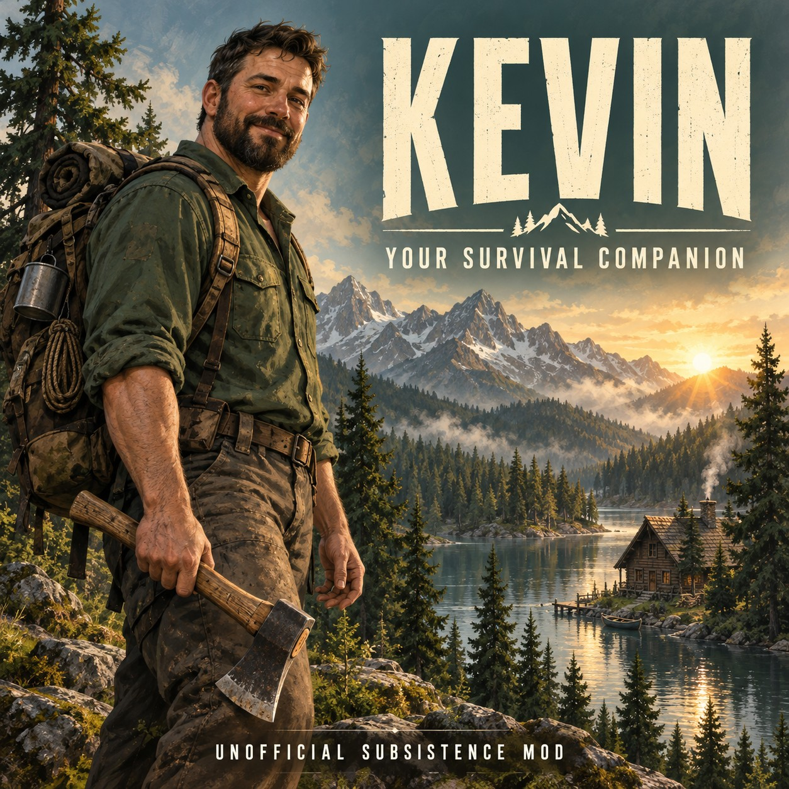

# Kevin Companion for Subsistence

## [DOWNLOAD KEVIN SETUP. CLICK HERE](https://github.com/SimpleNeb/Subsistence-Kevin/raw/5d660a03cc9f80c4625f47b23b0551f7241a069f/downloads/Kevin-Setup-0.2.6-preview-Alpha68.19.exe)

**0.2.6 preview · Windows · Single-player · Subsistence Alpha 68.19**

## A note from SimpleNeb about download warnings

**I will never add malware or unwanted software. This project exists to bring Kevin to life.**

I set up this GitHub account for Kevin and manage it myself. Setup installs Kevin's companion code, his "brain", which subscribing alone cannot add.

Setup is unsigned. Unknown-publisher or uncommon-download warnings can concern file reputation; they are not automatically malware detections. [Microsoft explains these warnings](https://learn.microsoft.com/en-us/windows/apps/package-and-deploy/smartscreen-reputation).

Microsoft Defender completed a custom scan of the 0.2.6 Setup, ZIP and included files with no matching detections recorded. Source and SHA256 checksums are public. Publisher signing is being prepared; this release remains unsigned.

**Subscribe AND run Setup. Both steps are required.** Subscription alone does
not install Kevin's companion code.

1. [Subscribe on Steam Workshop](https://steamcommunity.com/sharedfiles/filedetails/?id=3816609201).
2. Close Subsistence completely.
3. Download Kevin Setup above and open it from Downloads. No GitHub account is
   needed. You do not need the repository's Code / Download ZIP button.
4. Check the game folder in Setup. Use Browse to select the Subsistence folder
   containing **Binaries** and **UDKGame**. Steam Library → right-click Subsistence
   → Manage → Browse local files finds it. Click **Install / Update** and wait for
   **Kevin installed**.
5. Launch Subsistence → choose your single-player profile → **Mods** → select
   **Kevin Companion** → start or continue the profile.
6. Go outside onto clear ground. Kevin appears nearby when a safe place is
   available. No recruitment quest or special map location.

**Already installed?** Keep your subscription. Download the **new** Setup, close
the game and run Install / Update again. Steam does not automatically update
Kevin's installed code. Setup supports upgrading the earlier supported previews
through 0.2.5.

Prefer the complete installer ZIP? [Download it here](https://github.com/SimpleNeb/Subsistence-Kevin/raw/5d660a03cc9f80c4625f47b23b0551f7241a069f/downloads/Kevin-Companion-0.2.6-preview-Alpha68.19.zip), extract
the entire archive and run Install Kevin.cmd. Use Setup or this ZIP; you do not
need both. The repository's source ZIP is a different download.

## A friend for the wilderness

Kevin joins you automatically, carries supplies, wears the gear you give him and
helps defend against immediate threats. Send him to work, ask him to wait, or
bring him along for company on the trail.

## New in 0.2.6

Setup now reports the expected and actual file checksums and lengths, and gives
recovery steps when a game file has been modified. The companion gameplay and
patches are identical to 0.2.5. Existing 0.2.5 installations can upgrade normally.

If a fresh installation reports a mismatch, back up saves and preserve any
`.KevinLoader` folder. Restore a verified original game file or use Steam's
**Properties → Installed Files → Verify integrity**, then run Setup again.
Verification can replace other mods. If Kevin is already installed, preserve its
backups and [share the setup report](https://github.com/SimpleNeb/Subsistence-Kevin/issues)
before restoring files. Never force a patch onto an unknown file.

## Gameplay added in 0.2.5

- **Loot ordinary world boxes.** Kevin approaches eligible boxes and takes their
  actual contents that fit in his cargo. Leftover items remain in the box.
- **Collect scrap or Gather All.** All includes eligible boxes plus surface
  fiber, scrap, berries and supported native plants. It does not chop trees;
  Gather Wood remains the separate axe job.
- **A wider search.** Kevin looks farther for resources and keeps searching
  around his new position. Stay nearby: distance and terrain still limit work.
- **Defend with bows and arrows.** Hunting bows and recurve bows use the ordinary
  or premium arrows you supply. No grenade arrows; he stops when arrows run out.

Swimming and entering or interacting with a base remain deferred. Scavenging
excludes player storage, base containers, death bags, locked/special boxes,
underwater resources and cave loot. It uses real world items and native loot.
Dropped items, loose arrows and planted crops are excluded. After making cargo
room, issue the gathering command again to revisit leftovers.

## Quick controls

| What you want to do | Control |
| --- | --- |
| Open Kevin's inventory | Stand close and press your normal Use key |
| Give orders | Crouch close and press Use |
| Follow / Stay / Inventory | Menu keys 1 / 2 / 3 |
| Gather Wood / Gather Fiber | Menu keys 4 / 5 |
| Loot Boxes / Scrap Metal / Gather All | Menu keys 6 / 7 / 8 |
| Choose a command | Click, use number keys, or arrows and Enter |
| Recall Kevin | Close other menus, press F6, then click RECALL KEVIN |
| Close menu or recall cursor | Escape or right-click; F6 also closes recall |
| Revive / loot death bag | Crouch + Use / stand + Use |

Kevin has **35 cargo slots, seven toolbelt slots and six clothing slots**. Drag
items into him; shift-click into Kevin is disabled. Drag or shift-click items
back out when you have room. Put clothing and armor in matching slots.

Give a supported weapon in cargo or toolbelt and matching ammunition. Select
a supported ammo type before handing it over; Kevin does not change ammo types.
Put weapons and axes directly on the toolbelt, or leave one belt slot free so
Kevin can equip them from cargo.
Supported guns include M9, Red9, M37, double-barrel shotgun, rifle, lever-action
rifle and revolver. Loaded ammunition, upgrades, condition and the native
flashlight attachment's charge survive transfers. Bows accept ordinary or premium
arrows; choose that arrow type before giving Kevin the bow.

Wood needs a usable axe; fiber and scavenging need no tool. Tools wear, ammo runs
out, plants deplete and full cargo can stop work. Terrain and combat interrupt
jobs. Stay nearby and give a job again after loading, revival, recall or combat.

## Find or revive Kevin

The upper-right HUD shows his status. Close other menus, press **F6** to free the
cursor and click **RECALL KEVIN**. Living Kevin keeps his health and belongings.
Dead Kevin returns at half health with empty inventory; **his gear stays in the
original death bag**. Recall cancels work and resumes Follow. You must be alive
and have clear outdoor ground nearby.

You can also crouch + Use on the original bag to revive him or wait about two
minutes while the world runs. Stand + Use to recover its gear before normal bag
expiry. These routes do not copy equipment.

Read the [complete player guide](PLAYER-GUIDE.md) for ammunition, work, revival,
save and disable details.

## Windows or antivirus blocked it?

**Setup is unsigned.** Smart App Control can block unsigned apps and has no
individual-app exception. Keep protection enabled; do not add an exclusion to
install Kevin. A clean scan by one product does not settle another product's
detection. [Microsoft explains Smart App Control](https://support.microsoft.com/en-us/windows/security/threat-malware-protection/smart-app-control-frequently-asked-questions).

[Report the exact warning](https://github.com/SimpleNeb/Subsistence-Kevin/issues),
security product, detection name and Setup version. The ZIP is not a workaround
for a security block. If Setup opens but the game folder denies access, Retry as
administrator requests folder permission; it does not fix a security block.

For other errors use Save setup report. Remove personal folder names before
posting publicly. If Setup never opens, include the warning screenshot instead.
Do not force a patch over a game-version or checksum mismatch.

## Français. activer Kevin

Abonnez-vous, fermez le jeu et lancez Kevin Setup avec le lien en haut. Cliquez
sur Install / Update. Relancez Subsistence, ouvrez Mods dans votre profil solo,
sélectionnez Kevin Companion puis chargez la partie. Sortez sur un terrain
dégagé. Debout + Use : inventaire ; accroupi + Use : ordres. F6 puis RECALL KEVIN :
rappel. S'il est mort, son équipement reste dans son sac. Chaque mise à jour
nécessite le nouvel installateur.

## Compatibility and disabling

Remove Kevin from a profile's Mods selection to disable him there. To disable
globally, close the game and use Disable Kevin in Setup. Keep the game's
`.KevinLoader` backups and `KevinCompanion.u` for existing Kevin saves.

Windows, standalone single-player, Alpha 68.19. Outdoor surface terrain only;
caves, water, buildings and obstacles can block travel and work. Multiplayer,
building jobs and direct player control are not included. Recall is manual;
normal following does not teleport him. This is a controlled preview, not an
exhaustive public playtest of every terrain, weapon, enemy or mod combination.

[Build and validation details](BUILD-PROOF.md) distinguish fresh and inherited
checks. SHA256 checksums identify exact files; they are not a publisher signature.
Created by **SimpleNeb**. Unofficial; not affiliated with Subsistence's developer.
The cover is an illustration. You need your own game; original game files, SDK,
test packages and saves are not distributed.
